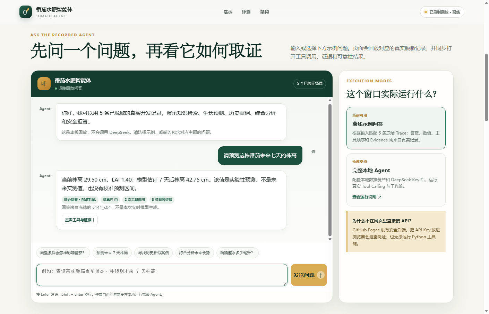
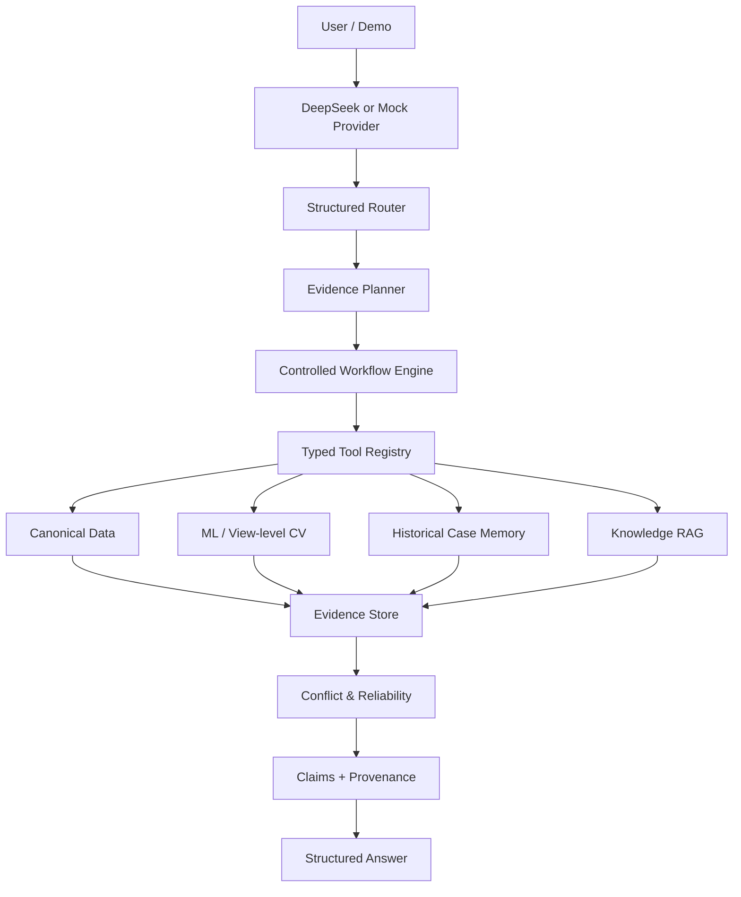
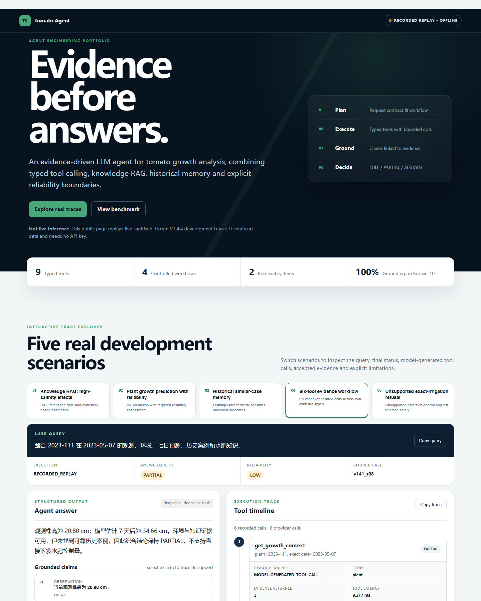
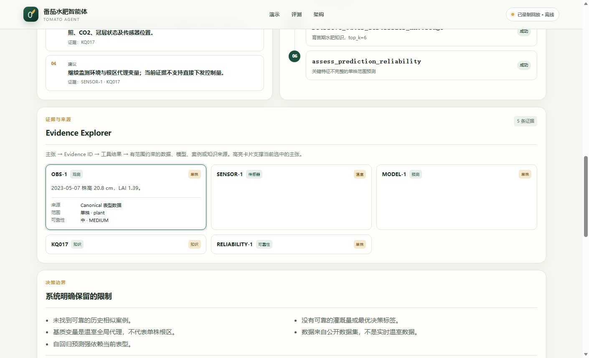

# Tomato Agent

**Evidence-driven LLM Agent with RAG & Historical Memory**

> **Public portfolio repository:** this isolated release contains only source code, sanitized Replay fixtures, example configuration and portfolio documentation. Research data, model weights, RAG documents, raw traces and the private holdout are intentionally absent. See [PUBLIC_RELEASE_MANIFEST.md](PUBLIC_RELEASE_MANIFEST.md).

[](https://github.com/Zhenwei-Chang/tomato-agent/actions/workflows/ci.yml) [](https://github.com/Zhenwei-Chang/tomato-agent/actions/workflows/pages.yml)

[在线 Recorded Replay](https://zhenwei-chang.github.io/tomato-agent/) · [English](README_EN.md) · [本地离线 Demo](demo/README.md) · [演示讲解](docs/portfolio/DEMO_WALKTHROUGH.md) · [架构](docs/architecture/SYSTEM_ARCHITECTURE.md) · [评测](docs/evaluation/BENCHMARK_SUMMARY.md) · [面试材料](docs/portfolio/INTERVIEW_PREPARATION.md)

Tomato Agent 是一个基于公开番茄数据构建的 Agent 工程原型。它通过 Typed Tool Calling 调度结构化数据、传统机器学习、View-level 视觉分析、历史案例记忆和农业知识 RAG，再将证据、范围、可靠性与限制组织成可追溯回答。

> LLM 不直接计算株高、LAI 或灌溉量。数值事实来自数据与专业模型工具；LLM 负责意图理解、工具调度和有证据边界的结果组织。

当前系统是 **public-data-based decision-support prototype**，不是自动灌溉控制系统，也不提供生产级精确水肥处方。



## 为什么它不只是 RAG Chatbot

- **9 个 Pydantic Typed Tools**：参数校验、未知工具拒绝、参数修复、调用预算与重复调用处理。
- **4 条受控 Workflow**：growth status、growth forecast、knowledge QA、comprehensive diagnosis。
- **两类检索**：知识 RAG 检索农艺文献证据；Historical Case Memory 检索带时间约束的相似观测与后续结果。
- **Evidence-first**：Claim 必须关联 Evidence，Evidence 再关联 Tool Result 与数据/模型/知识来源。
- **可靠性与拒答**：保留 plant/view/greenhouse/knowledge scope，并支持 FULL / PARTIAL / ABSTAIN。
- **真实 Agent Eval**：除确定性测试外，保留真实 DeepSeek Function Calling、人工复核、Trace、Token、延迟和成本记录。

## 系统架构



完整图：[System Architecture](docs/architecture/SYSTEM_ARCHITECTURE.md) · [Function Calling Flow](docs/architecture/FUNCTION_CALLING_FLOW.md) · [Evidence Provenance](docs/architecture/EVIDENCE_PROVENANCE.md)

## 30 秒离线体验

无需安装的在线展示：[https://zhenwei-chang.github.io/tomato-agent/](https://zhenwei-chang.github.io/tomato-agent/)。页面提供中文问答窗口，可输入或选择 5 个已验证示例，并回放对应的工具调用、证据与可靠性结果。它明确标注为 Recorded Replay，不会调用 DeepSeek；示例范围之外的问题会说明限制，不会伪装成任意自由文本推理。

要求 Python 3.11+；不需要 API Key、PyTorch、模型权重或 26 GB 原始数据。

```powershell
python demo/app.py
```

浏览器打开 `http://127.0.0.1:8765`。页面显著标记为 **Recorded Replay / Offline Demo**：它展示冻结、脱敏的真实开发 Trace，不会冒充实时推理。

终端模式：

```powershell
python -m tomato_fertigation_agent.portfolio_demo list
python -m tomato_fertigation_agent.portfolio_demo show comprehensive
python -m tomato_fertigation_agent.portfolio_demo check
```

## 三种运行级别

| 模式 | 依赖 | 是否联网 | 用途 |
|---|---|---:|---|
| Offline Replay | Python 标准库 | 否 | 面试与快速审阅；播放脱敏冻结结果 |
| Local Agent | 本地 canonical data、case memory、checkpoint、RAG snapshot | 默认否 | 执行真实工具链与 Mock/本地 Workflow |
| DeepSeek Online | Local Agent + `openai` SDK + 显式 API 配置 | 是 | 真实无状态多轮 Function Calling |

本地完整安装：

```powershell
python -m pip install -e ".[local,test]"
tomato-tools tools list
tomato-tools agent ask --query "查询植株 2023-111 在 2023-05-07 的状态" --debug
```

Vision 另装 `.[vision]`。在线调用另装 `.[online]`，复制 `.env.example` 的变量到进程环境，并显式启用在线模式。仓库不会自动联网，也不会自动寻找旧项目密钥。

## 可复现演示

1. **Knowledge RAG**：高盐问题没有足够相关证据时正确 ABSTAIN；该开发案例也暴露了当时自动评分与预期状态的差异。
2. **Growth Prediction**：精确日期状态 → 锁定的 t+7 株高模型 → scope 与 rule-based reliability。
3. **Historical Memory**：跨实体历史案例、时间泄漏保护、相似度、真实后续结果与 OOD 警告。
4. **Comprehensive Agent**：6 个模型生成的 Tool Calls；观测、环境、预测、案例、知识和可靠性汇总为 PARTIAL。
5. **Safety**：对无标签支持的“精确灌水多少毫升”在工具执行前拒答。

所有回放 Fixture 都来自已知开发集，不是独立 Holdout。详见 [Demo 说明](demo/README.md)。

### 可追踪的六工具场景





## Tool Registry

| Tool | 职责 | 主要 scope |
|---|---|---|
| `get_growth_context` | 精确日期表型、处理、品种与可用图像 | plant / view / dataset |
| `get_sensor_history` | 指定结束日期的日级传感器窗口 | greenhouse |
| `get_treatment_recipe` | 处理配方、元素量与派生字段 | treatment |
| `predict_height_t7` | 锁定模型的 7 天株高预测 | plant |
| `analyze_rgb` | 当前/未来 View 平均株高估计 | view |
| `get_image_embedding` | Frozen ResNet18 512D 表示 | view |
| `retrieve_water_fertilizer_knowledge` | 复用已有番茄知识 RAG，只检索证据 | knowledge |
| `assess_prediction_reliability` | 非校准、规则化可靠性判断 | requested scope |
| `find_similar_cases` | Plant/View 历史案例检索与时间约束 | plant / view |

## 冻结 Benchmark

最近一次真实在线结果是 **V1.4.4、DeepSeek `deepseek-flash`、10 条已知开发案例**：

| Metric | Result |
|---|---:|
| Tool Selection F1 | 96.67% |
| Argument Accuracy | 100% |
| Evidence Grounding | 100% |
| Provenance Completeness | 100% |
| Human PASS | 8/10 |
| Strict Automatic PASS | 5/10 |
| Scope Violation | 0 |
| Unsupported Numerical Claim | 0 |

V1.4.5 修复目前只有离线合同回归（140 passed、2 skipped；Known-10 10/10），**没有新的 DeepSeek 在线结论**。48-case independent holdout 为 **NOT_RUN**。指标分母、Bad Case 和冻结哈希见 [Benchmark Summary](docs/evaluation/BENCHMARK_SUMMARY.md)。

## 关键工程选择

- 固定 Workflow 约束高风险农业任务，自由 Function Calling 负责参数化工具选择，两者并非二选一。
- Registry 是唯一合法 Tool Name 来源，Pydantic 是参数边界；未知工具不会被执行。
- Plant 与 View scope 不互换：现有 RGB 是 View/group 粒度，不伪装成单株视觉。
- Case Memory 的 `historical_only` 与 outcome timestamp 检查防止未来信息进入检索结果。
- Reliability 是规则化审计信号，不是统计校准概率。
- 不训练“最佳灌水量”：公开数据没有逐次灌溉量、施肥量或最优决策标签。

详见 [Engineering Decisions](docs/portfolio/ENGINEERING_DECISIONS.md)。

## 数据与资产边界

仓库发布包不应包含 26 GB 原始数据、大量 RGB、完整 RAG 文献、完整 Case Memory、本机 Trace 或密钥。Offline Demo 只携带少量脱敏 JSON。

项目代码许可尚未由权利人最终指定，因此本仓库当前**不附带开源 LICENSE**。公开数据、文献和 ImageNet 预训练权重各有独立条款；“公开可下载”不等于允许重新分发。见 [Asset & License Policy](docs/portfolio/ASSET_AND_LICENSE_POLICY.md)。

项目权利人已确认拥有或取得当前候选内容的公开展示授权。本仓库未附项目许可证；公开可见仅用于作品集审阅，不代表第三方获得复制、修改或再分发授权。

## 已知限制

- 公开数据而非实时温室；Sensor 跨季 domain shift 明显。
- RGB 是 View-level，且存在背景/机位 shortcut 风险。
- 基质变量是 greenhouse-global proxy，没有可靠 Probe → View 映射。
- t+7 株高预测强依赖当前表型；LAI 与 growth delta 不稳定。
- 没有真实灌溉量、施肥事件和最优控制标签。
- Known-10 用于过开发调试，不能代表跨任务泛化。

## 面试与复核入口

- [真实六工具 Trace Showcase](docs/evaluation/TRACE_SHOWCASE.md)
- [工程决策与三个 Bad Cases](docs/portfolio/ENGINEERING_DECISIONS.md)
- [一分钟/三分钟介绍与 20+ 技术问答](docs/portfolio/INTERVIEW_PREPARATION.md)
- [中英文简历描述](docs/portfolio/RESUME_PROJECT.md)
- [发布清单](docs/portfolio/RELEASE_CHECKLIST.md)

## Roadmap

作品集版本在此停止扩展农业功能。后续仅在获得独立评测授权后运行 V1.4.5 在线回归与 48-case Holdout；真实温室单株 RGB、局部根区传感器、灌溉/施肥事件和闭环控制留在科研分支。
