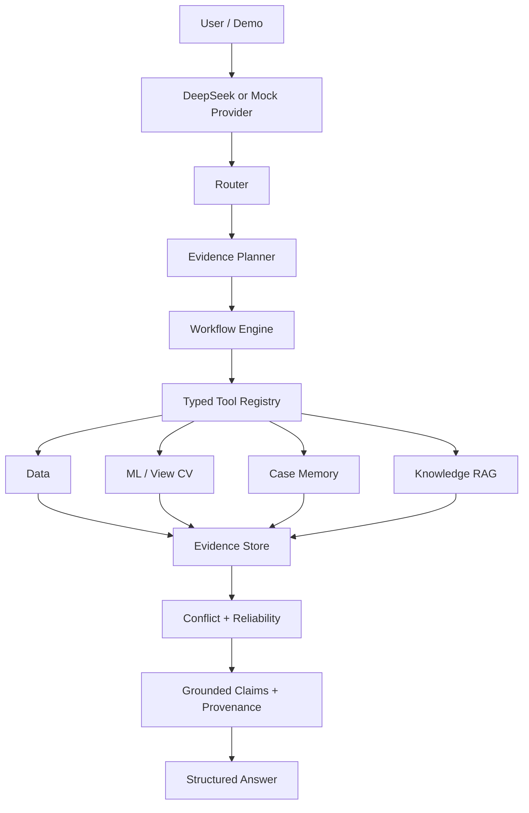

# Tomato Agent

**Evidence-driven LLM Agent with RAG & Historical Memory**

> **Public portfolio repository:** this isolated release includes source code, sanitized Replay fixtures, example configuration, and portfolio documentation only. Research data, model weights, RAG documents, raw traces, and the private holdout are intentionally absent. See [PUBLIC_RELEASE_MANIFEST.md](PUBLIC_RELEASE_MANIFEST.md).

[](https://github.com/Zhenwei-Chang/tomato-agent/actions/workflows/ci.yml) [](https://github.com/Zhenwei-Chang/tomato-agent/actions/workflows/pages.yml)

[Live Recorded Replay](https://zhenwei-chang.github.io/tomato-agent/) · [中文](README.md) · [Local Offline Demo](demo/README.md) · [Demo Walkthrough](docs/portfolio/DEMO_WALKTHROUGH.md) · [Architecture](docs/architecture/SYSTEM_ARCHITECTURE.md) · [Evaluation](docs/evaluation/BENCHMARK_SUMMARY.md)

Tomato Agent is a public-data-based decision-support prototype that orchestrates typed data, ML/CV, historical-memory, and agricultural knowledge tools. The LLM does **not** calculate plant height or irrigation amounts by language alone: specialized tools produce structured signals, while the Agent plans calls, validates arguments, aggregates evidence, preserves scope, and resolves FULL / PARTIAL / ABSTAIN answers.

It is not an automatic irrigation controller and does not provide production-grade fertigation prescriptions.


## Highlights

- 9 Pydantic-typed atomic tools with registry-driven schemas.
- Stateless multi-turn DeepSeek Responses-style function-calling loop.
- Four controlled workflows for status, forecast, knowledge QA, and comprehensive diagnosis.
- Knowledge RAG plus 12,168 Plant and 1,001 View historical cases.
- Temporal-leakage guard, OOD checks, conflict analysis, and rule-based reliability.
- Claim → Evidence → Tool Result → Source provenance.
- Deterministic tests, real-provider evaluation, traces, bad-case analysis, token/latency/cost accounting.

## Architecture



See the [full architecture](docs/architecture/SYSTEM_ARCHITECTURE.md), [function-calling loop](docs/architecture/FUNCTION_CALLING_FLOW.md), and [provenance model](docs/architecture/EVIDENCE_PROVENANCE.md).

## Quick Start — Offline Replay

No-install web demo: [https://zhenwei-chang.github.io/tomato-agent/](https://zhenwei-chang.github.io/tomato-agent/). It is explicitly labelled Recorded Replay, makes no DeepSeek call, and does not pretend to support arbitrary live prompts.

Python 3.11+ is sufficient. No API key, model weight, PyTorch install, or 26 GB dataset is required.

```powershell
python demo/app.py
```

Open `http://127.0.0.1:8765`. The UI is explicitly labelled **Recorded Replay**. It renders sanitized frozen development traces and performs no live inference.

```powershell
python -m tomato_fertigation_agent.portfolio_demo list
python -m tomato_fertigation_agent.portfolio_demo show comprehensive
python -m tomato_fertigation_agent.portfolio_demo check
```

## Execution Modes

| Mode | Runtime | Network |
|---|---|---:|
| Offline Replay | Sanitized fixtures only | No |
| Local Agent | Local canonical data, checkpoints, RAG snapshot, and case memory | Off by default |
| DeepSeek Online | Explicit provider configuration and outbound-data consent | Yes |

Full local tools:

```powershell
python -m pip install -e ".[local,test]"
tomato-tools tools list
```

Install `.[vision]` only for live image analysis and `.[online]` only for external-provider execution. The repository never auto-discovers or uploads legacy credentials.

## Recorded Scenarios

1. Knowledge RAG with evidence rejection and abstention.
2. Exact-date current state, t+7 height prediction, and reliability.
3. Historical-only cross-entity case retrieval with observed outcomes and OOD warnings.
4. A six-tool comprehensive workflow ending in PARTIAL because reliable case evidence is missing.
5. Safety refusal for an unsupported exact per-plant irrigation volume.

These are known development cases, not an independent holdout.

### Traceable six-tool scenario


## Tool Registry

`get_growth_context`, `get_sensor_history`, `get_treatment_recipe`, `predict_height_t7`, `analyze_rgb`, `get_image_embedding`, `retrieve_water_fertilizer_knowledge`, `assess_prediction_reliability`, and `find_similar_cases`.

Every result retains status, scope, source/model metadata, warnings, evidence, and limitations. RGB outputs remain View-level; they are never presented as single-plant measurements.

## Frozen Evaluation

The latest real online run is V1.4.4 on 10 known development cases with `deepseek-flash`:

| Metric | Result |
|---|---:|
| Tool Selection F1 | 96.67% |
| Argument Accuracy | 100% |
| Evidence Grounding | 100% |
| Provenance Completeness | 100% |
| Human PASS | 8/10 |
| Strict Automatic PASS | 5/10 |
| Scope Violations | 0 |
| Unsupported Numerical Claims | 0 |

V1.4.5 has only deterministic offline validation (140 passed, 2 skipped; Known-10 10/10). It has **not** been revalidated online. The independent 48-case holdout is **NOT_RUN**. See [Benchmark Summary](docs/evaluation/BENCHMARK_SUMMARY.md).

## Known Limitations

- Public research data, not a live greenhouse.
- Strong cross-season sensor shift.
- View-level RGB with documented background/view shortcuts.
- No reliable probe-to-View mapping.
- Autoregressive forecasting relies heavily on current phenotype.
- No per-event irrigation/fertilization or optimal-control labels.
- Known-10 was used during development and cannot establish generalization.

## Distribution Boundary

The portfolio excludes raw data, bulk RGB, complete document PDFs, full case memory, local traces, credentials, and unverified third-party assets. The project owner has not yet selected a code license, so no open-source `LICENSE` is asserted. See [Asset & License Policy](docs/portfolio/ASSET_AND_LICENSE_POLICY.md) and the [Release Checklist](docs/portfolio/RELEASE_CHECKLIST.md).

The rights holder has confirmed ownership or authorization for public display of the current candidate contents. No project license is granted: public visibility is for portfolio review and does not grant permission to copy, modify, or redistribute the code.
