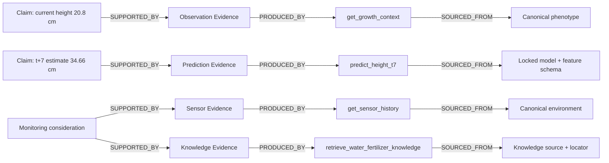
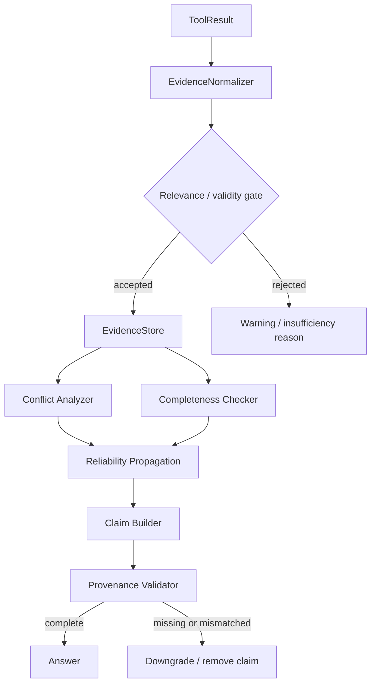

# Evidence & Provenance

The Agent treats a fluent answer as insufficient unless its claims can be traced to accepted evidence.

## Evidence lifecycle

## Scope is part of evidence

`plant`, `view`, `greenhouse`, `treatment`, and `knowledge` are not cosmetic labels. A View-level RGB estimate cannot support an exact Plant-level claim. Substrate moisture marked `greenhouse_global_proxy` cannot be described as that plant's measured root-zone moisture.

## Reliability is not probability

HIGH / MEDIUM / LOW / UNKNOWN are rule-based audit levels. They summarize scope match, critical feature availability, known domain, evidence completeness, model/case agreement and known limitations. They are explicitly marked `statistically_calibrated=false`.
