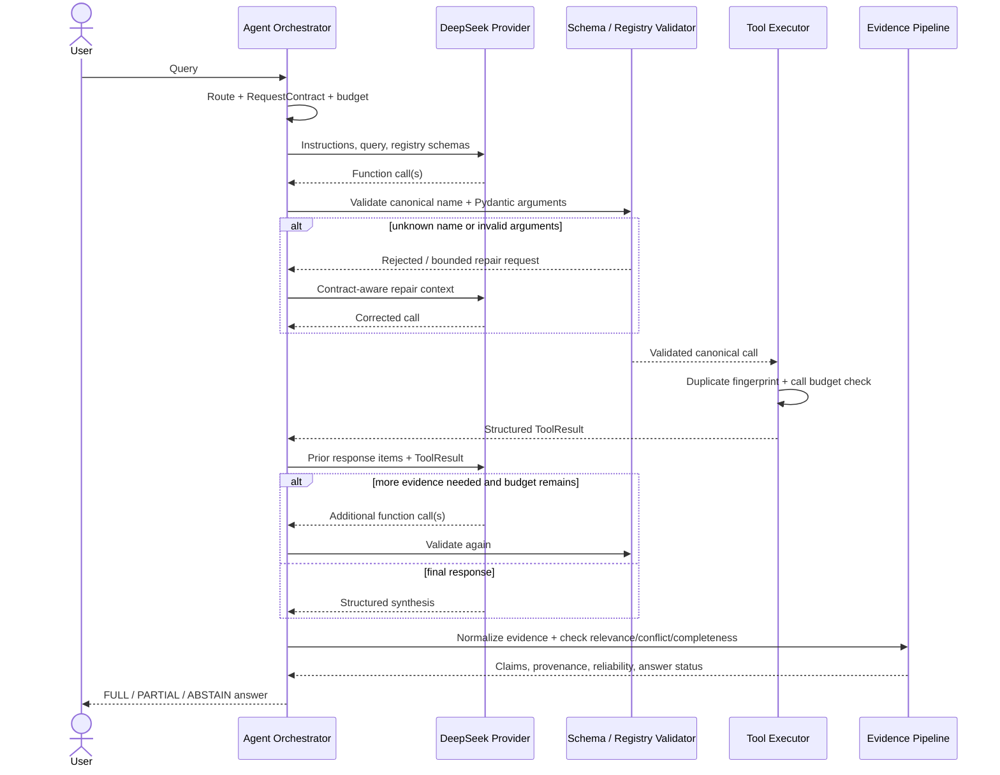

# Function Calling Flow

The online loop is stateless at the transport layer: each continuation sends the required provider response items and tool outputs explicitly. Agent state, budgets and duplicate fingerprints are maintained by the application.

## Guardrails

1. Tool names are exported from the registry; an LLM string cannot create a callable.
2. Arguments are parsed by the tool's Pydantic input model before dispatch.
3. Repair is bounded by `max_argument_repairs` and `max_tool_plan_repairs`.
4. Duplicate calls are detected from canonical name plus normalized arguments.
5. Provider/tool budgets terminate runaway loops.
6. Provider errors become structured states; deterministic fallbacks never masquerade as model-generated calls.
7. Final status is resolved against the original RequestContract, not against limitations invented during synthesis.
