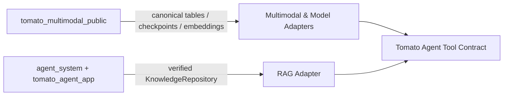

# System Architecture

Tomato Agent separates language reasoning from numerical and evidential computation. Provider-generated calls may choose among registered tools, but execution, scope, evidence, safety and final status remain bounded by deterministic contracts.

```mermaid
flowchart TB
    UI[CLI / Portfolio Demo / Future UI]
    UI --> MODE{Execution mode}
    MODE -->|Recorded Replay| FIX[Sanitized frozen fixtures]
    MODE -->|Local| MOCK[Mock provider / controlled workflow]
    MODE -->|Explicit online| LLM[DeepSeek Responses-compatible provider]

    MOCK --> ROUTER[Structured Router]
    LLM --> ROUTER
    ROUTER --> CONTRACT[Request Contract]
    CONTRACT --> PLAN[Evidence Planner]
    PLAN --> ENGINE[Workflow Engine]
    ENGINE --> REG[Registry-driven Typed Tools]

    REG --> DATA[Canonical data adapter]
    REG --> ML[Height model adapter]
    REG --> CV[View-level RGB adapter]
    REG --> CASE[Historical Case Memory]
    REG --> RAG[Existing Tomato Knowledge RAG]
    REG --> REL[Rule-based reliability]

    DATA & ML & CV & CASE & RAG & REL --> NORM[Evidence Normalizer]
    NORM --> STORE[Evidence Store]
    STORE --> CONFLICT[Conflict Analyzer]
    STORE --> COMPLETE[Completeness Checker]
    CONFLICT & COMPLETE --> PROP[Reliability Propagator]
    PROP --> CLAIMS[Claims + Provenance Graph]
    CLAIMS --> SAFE[Scope and Numerical Safety]
    SAFE --> STATUS[FULL / PARTIAL / ABSTAIN]
    STATUS --> ANSWER[Structured Answer]
    ANSWER --> TRACE[Trace + Evaluation]

    FIX --> VIEW[Replay Renderer]
```

## Runtime boundaries

- **Recorded Replay** never constructs the Tool Registry and never imports pandas, scikit-learn, PyTorch or the provider SDK.
- **Local Agent** requires sibling research/RAG assets but does not require network access.
- **Online Agent** is opt-in. The provider sees only the explicitly prepared query/tool context; credentials remain server-side.
- **No execution path controls irrigation hardware.** The safety boundary stops at analysis and evidence-backed monitoring considerations.

## Existing assets are adapted, not copied

The RAG adapter imports the existing verified repository and returns retrieval evidence. It does not create a second vector store or let the old RAG generate the final Agent answer.
